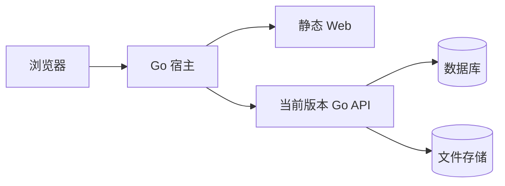

# NeoCloud

支持文件管理、分享协作与媒体阅读的自托管文件工作区。适合希望自行管理文件、账号权限和部署环境的个人与团队。

[下载正式版](https://github.com/reina0721/neocloud/releases/latest) · [使用手册](docs/README.md) · [贡献指南](CONTRIBUTING.md) · [获取帮助](SUPPORT.md) · [报告安全问题](SECURITY.md)

## 可以做什么

- **管理文件**：私有目录、搜索、复制、文本编辑、回收恢复、私有版本、ZIP/7Z 和 WebDAV。
- **传输与协作**：持久上传与续传、HTTP/BT 下载、分享链接和文件权限。
- **阅读媒体**：PDF、图片、电子书、音视频与音乐播放器。
- **管理工作区**：账号、角色与权限、组织、导航、通知、待办和运维入口。

文件入口为 `/home`，管理入口为 `/workspace`。界面采用基于 MUI 的 [Material Design 3](frontend/docs/ui-visual-calibration.md)。具体能力、预算和使用方式见[文件管理手册](docs/operations/file-management.md)。

项目处于 **0.x 迭代阶段**，正式交付及版本变更以 [GitHub Releases](https://github.com/reina0721/neocloud/releases) 为准。BT 面向受信节点；无共享挂载的远程下载代理、脱离分享链接的跨账号挂载共享尚未实现；外部 Office 服务需要单独联调。部分 Reference 页面仅用于演示和确定性验证。完整边界见[项目范围](docs/repository-scope.md)。

## 安装与部署

以下指南以 `v0.4.0` 的发布格式为例，从安装依赖写到首次设置和日常维护。发布包以 [GitHub Releases](https://github.com/reina0721/neocloud/releases) 上的公开标签为准。

从 v0.4.0 起，安装和升级使用 NeoCloud 格式。更早的发行版请保留原实例和备份，为 NeoCloud 选择独立安装目录和数据位置。

| 部署方式 | 系统与架构 | 目标机需要 | 默认 Web 端口 |
| --- | --- | --- | --- |
| [原生整包](docs/operations/backend-archive.md#运行原生-go-与-web-整包) | Windows amd64、Linux amd64/arm64 | 签名整包和 Cosign，网页由 Go 宿主提供 | `8080` |
| [Docker 正式版](docs/operations/neocloud-deployment.md#release-下载版安装与升级) · [离线安装](docs/operations/neocloud-deployment.md#自动化与离线安装) | Linux amd64/arm64 | Docker Engine、Compose 和 Cosign，镜像从 GitHub Release 归档导入 | `4173` |
| [Docker 源码构建](docs/operations/neocloud-deployment.md#从源码部署) | Linux amd64/arm64 | Git、Docker Engine、Compose 和构建所需的网络访问 | `4180` |
| [无 Docker 源码部署](docs/operations/neocloud-deployment.md#构建与进程) | Windows amd64、Linux amd64/arm64 | 构建用 Git、Go 和 Node，运行打包后的 Web Host 用 Node | `4173` |

首次启动后，访问所选入口的 `/setup`，使用该实例的设置令牌创建管理员。服务器只监听回环地址时，可用 SSH 转发完成设置，再配置对外访问。[远程访问与 HTTPS](docs/operations/neocloud-deployment.md#远程访问与-https)

## 源码开发

需要 Go **1.26.11** 或更新版本和带 npm 的 Node **24**。克隆仓库后运行：

```bash
git clone https://github.com/reina0721/neocloud.git
cd neocloud
node scripts/dev.mjs
```

启动完成后按终端提示进入登录页或首次设置页。新实例的设置令牌默认位于本地忽略目录 `.data/dev/setup-token`。启动前自动使用 pnpm **10.22.0** 按锁文件同步前端依赖，随后准备配置、迁移数据库并检查服务就绪。Ctrl+C 停止其拥有的服务。隔离真实预览使用 `node scripts/dev.mjs --preview`。已有数据库与文件须保留，不作为可随意清空的测试夹具。Windows 命令、完整前置与排障见[本地开发](docs/getting-started/local-development.md)。

使用 `node scripts/dev.mjs --acceptance` 在全新 SQLite 上运行真实浏览器验收。

## 结构与验证

前后端同仓发布。原生整包由 Go 宿主同源提供静态页面和 Go API。本地开发由 Next.js 提供热刷新，Go 服务单独运行。业务共享同一套 IAM、数据库和 Storage。



| 目录                   | 职责                                     |
| ---------------------- | ---------------------------------------- |
| `cmd/`、`internal/`    | Go 入口、业务模块、装配与传输            |
| `pkg/`                 | 业务消费的公共底层能力                   |
| `frontend/`            | Next.js Web Host、产品插件与公共界面基础 |
| `api/`                 | OpenAPI 与生成契约                       |
| `docs/`                | 使用、开发、架构与运维手册               |
| `scripts/`、`.github/` | 开发验证、容器、协作与发布自动化         |

日常先确认改动范围：

```bash
node scripts/verify-changed.mjs --dry-run
node scripts/verify-changed.mjs
```

完整后端、前端、浏览器与真实服务的准备和证据边界见[验证策略](docs/development/validation.md)。参与开发从[贡献指南](CONTRIBUTING.md)进入；架构见[项目架构](docs/architecture/README.md)，发布维护见[发布说明](docs/operations/release.md)。

## 来源与许可

项目采用 [Apache-2.0](LICENSE)，保留 [NOTICE](NOTICE) 与第三方许可。后端源于 community-go，前端源于 console-web；导入的源码快照、分支和完整提交号见 [SOURCES.json](SOURCES.json) 与[来源记录](docs/provenance/README.md)。Go module 为 `github.com/reina0721/neocloud`，GitHub 仓库地址为 `reina0721/neocloud`。

缺陷、需求和使用问题请参阅[支持指南](SUPPORT.md)，潜在漏洞请通过[私密安全渠道](SECURITY.md)报告。
