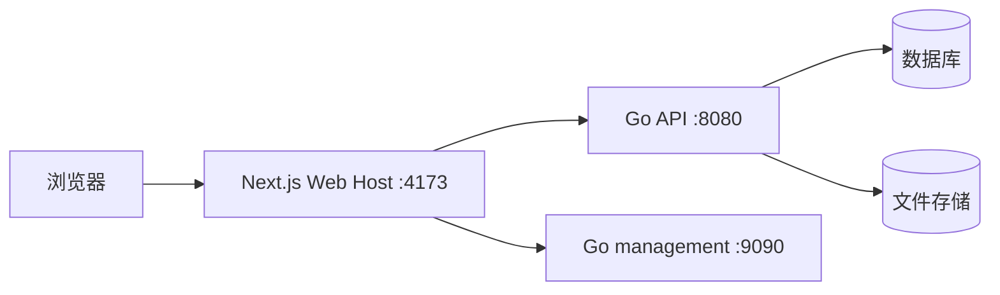

# CloudDrive

支持文件管理、分享协作与媒体阅读的自托管文件工作区。适合希望自行管理文件、账号权限和部署环境的个人与团队。

[下载正式版](https://github.com/reina0721/neocloud/releases/latest) · [使用手册](docs/README.md) · [贡献指南](CONTRIBUTING.md) · [获取帮助](SUPPORT.md) · [报告安全问题](SECURITY.md)

## 可以做什么

- **管理文件**：私有目录、搜索、复制、文本编辑、回收恢复、私有版本、ZIP/7Z 和 WebDAV。
- **传输与协作**：持久上传与续传、HTTP/BT 下载、分享链接和文件权限。
- **阅读媒体**：PDF、图片、电子书、音视频与音乐播放器。
- **管理工作区**：账号、角色与权限、组织、导航、通知、待办和运维入口。

文件入口为 `/home`，管理入口为 `/workspace`。界面采用基于 MUI 的 [Material Design 3](frontend/docs/ui-visual-calibration.md)。具体能力、预算和使用方式见[文件管理手册](docs/operations/file-management.md)。

项目处于 **0.x 迭代阶段**，正式交付及版本变更以 [GitHub Releases](https://github.com/reina0721/neocloud/releases) 为准。BT 面向受信节点；无共享挂载的远程下载代理、脱离分享链接的跨账号挂载共享尚未实现；外部 Office 服务需要单独联调。部分 Reference 页面仅用于演示和确定性验证。完整边界见[项目范围](docs/repository-scope.md)。

## 下载部署

Release 提供 Linux amd64/arm64 配套 Docker 离线镜像包。目标机需要 Docker、Compose 插件与标准 Linux 工具，无需 Go、Node 或源码编译。安装器从 GitHub 下载产物后导入本地 Docker。

```bash
curl -fL --proto '=https' --proto-redir '=https' \
  https://github.com/reina0721/neocloud/releases/latest/download/install.sh -o install.sh
bash install.sh install --dir "$HOME/clouddrive" --bind 127.0.0.1
```

上例监听服务器的 `127.0.0.1:4173`。在服务器上打开 `http://127.0.0.1:4173/setup`，使用 `~/clouddrive/.control/setup-token` 的令牌创建管理员。SQLite、文件和传输暂存保存在 `~/clouddrive/data/`。外网访问、TLS 和反向代理由部署方配置。

```bash
~/clouddrive/install.sh check-update  # 检查正式版
~/clouddrive/install.sh upgrade       # 备份并升级
```

升级前阅读目标版本说明并核验备份。Release 包含签名维护工具时，可启用同址网页运维，在 `/maintenance` 检查更新、备份、升级和恢复。具体条件见[网页运维说明](docs/operations/clouddrive-deployment.md#网页运维)。安装选项、签名与校验、数据位置、HTTP/TLS 和故障恢复见[安装与升级](docs/operations/clouddrive-deployment.md#release-下载版安装与升级)。Release 中的 Windows/Linux amd64 Go 归档仅包含后端，完整网页需要独立 Web Host。

## 源码开发

需要 Go **1.26.11** 和带 npm 的 Node **24**。克隆仓库后运行：

```bash
git clone https://github.com/reina0721/neocloud.git
cd neocloud
node scripts/dev.mjs
```

首次访问 `http://127.0.0.1:4173/setup`；设置令牌位于本地忽略目录 `.data/dev/setup-token`。启动前自动使用 pnpm **10.22.0** 按锁文件同步前端依赖，随后准备配置、迁移数据库并检查服务就绪。Ctrl+C 停止其拥有的服务。隔离真实预览使用 `node scripts/dev.mjs --preview`。已有数据库与文件须保留，不作为可随意清空的测试夹具。Windows 命令、完整前置与排障见[本地开发](docs/getting-started/local-development.md)。

## 结构与验证

前后端同仓发布、分进程运行；浏览器通过 Web Host 同源代理访问 Go API，后端共用 IAM、数据库和 Storage。



| 目录                   | 职责                                     |
| ---------------------- | ---------------------------------------- |
| `cmd/`、`internal/`    | Go 入口、业务模块、装配与传输            |
| `pkg/`                 | 业务消费的公共底层能力                   |
| `frontend/`            | Next.js Web Host、产品插件与公共界面基础 |
| `api/`                 | OpenAPI 与生成契约                       |
| `docs/`                | 使用、开发、架构与运维手册               |
| `scripts/`、`.github/` | 开发验证、容器、协作与发布自动化         |

日常先确认改动范围：

```bash
node scripts/verify-changed.mjs --dry-run
node scripts/verify-changed.mjs
```

完整后端、前端、浏览器与真实服务的准备和证据边界见[验证策略](docs/development/validation.md)。参与开发从[贡献指南](CONTRIBUTING.md)进入；架构见[项目架构](docs/architecture/README.md)，发布维护见[发布说明](docs/operations/release.md)。

## 来源与许可

项目采用 [Apache-2.0](LICENSE)，保留 [NOTICE](NOTICE) 与第三方许可。后端源于 community-go，前端源于 console-web；导入的源码快照、分支和完整提交号见 [SOURCES.json](SOURCES.json) 与[来源记录](docs/provenance/README.md)。Go module 保留 `github.com/reina0721/clouddrive`，GitHub 仓库地址为 `reina0721/neocloud`。

缺陷、需求和使用问题请参阅[支持指南](SUPPORT.md)，潜在漏洞请通过[私密安全渠道](SECURITY.md)报告。
